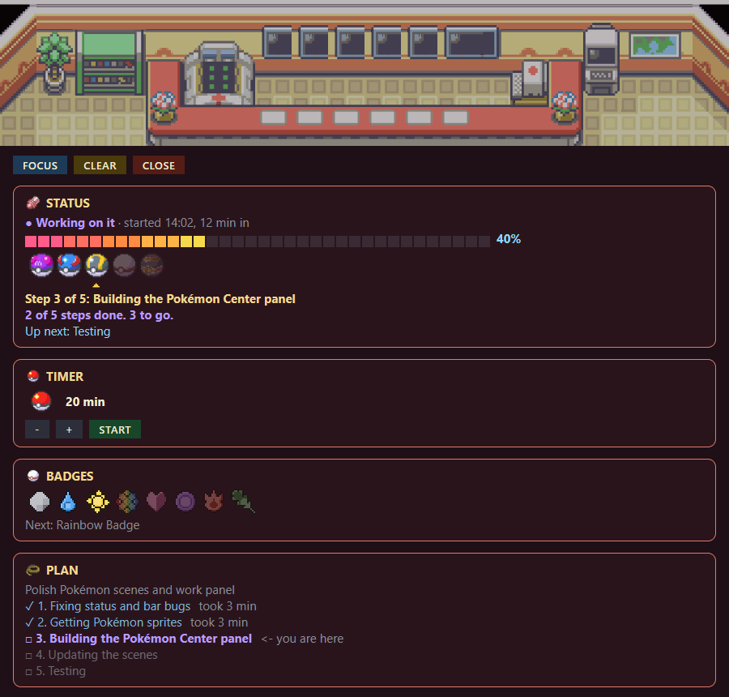
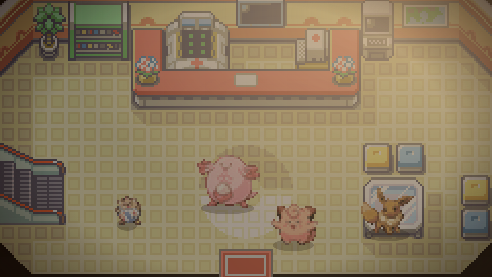
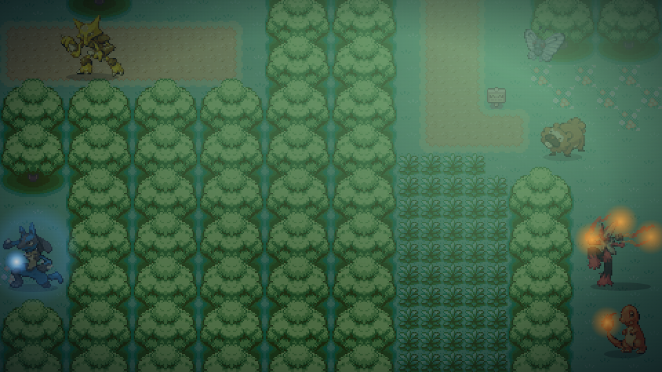
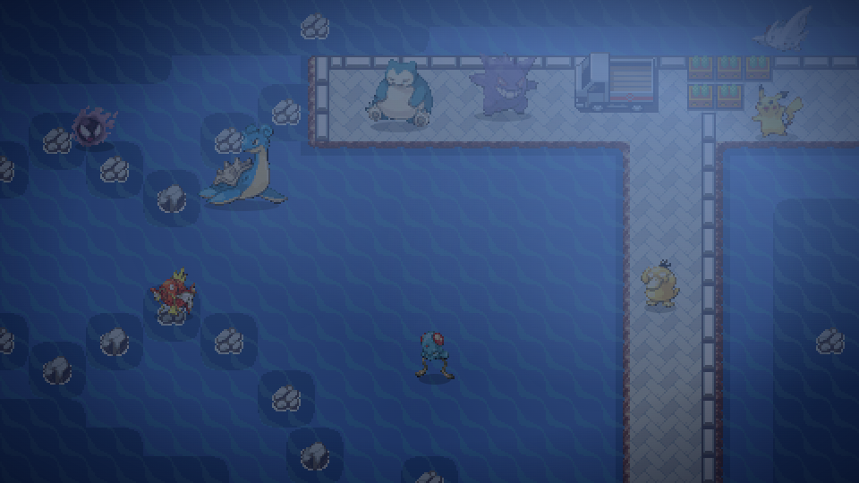

<p align="center">
      <br>
       
</p>

# claude-work-panel

**A live panel that shows what Claude Code is doing right now, so you can stop asking "where are you at?"**

Type `/work` and you see the plan, which step Claude is on, how much is done, and what it needs from you. It has a Pokémon Center theme if you want one, and a plain look if you don't.

## In one minute

- **The problem:** when Claude works on a long job, you can't see how far along it is. You ask. It guesses. You ask again.
- **The fix:** Claude writes a short plan first and reports real counts as it goes. The panel shows them live.
- **What you do:** nothing. Install it, type `/work`, and keep talking to Claude like always.

I made this because I have ADHD and kept losing track of what the agent was doing. A wall of text does not tell you how far along you are. A bar and a few real numbers do. It is written to be easy to read at a glance, whether or not your brain works like mine.

## What it looks like



*A preview render built from the plugin's own art and colours. In the app it updates live.*

From top to bottom:

| Part | What it tells you |
|---|---|
| **Status** | One plain label: Idle, Working on it, Waiting for your answer, Between steps, Finished, Stopped, or Hit a problem. |
| **Bar and balls** | The bar fills from real finished work. The row of balls has one ball per step. Finished steps are lit and a yellow marker points at the step Claude is on. |
| **Step line** | "Step 3 of 5: Building the panel." No guessing which step you are on. |
| **Timer** | A Poké Ball that rocks while time runs and goes still when it ends. Good for "just start for 5 minutes". |
| **Badges** | One Kanto gym badge for each task that was real work. The case resets every Monday. |
| **Plan** | The full checklist, with a tick for done and an arrow at the current step. |

## The theme

The theme also changes the whole Claude window into a night scene from the Kanto games. This part is my own plugin and is not in this repo.





## How it works

1. **You give Claude a task.** Nothing changes for you.
2. **Claude plans first.** If the job can be counted (105 emails), it records the total. If it is bigger, it lists the steps.
3. **Claude reports real numbers.** After each chunk it updates the count, like `35 of 105 done`. These are counts of finished work, never a guess at time left.
4. **The panel shows it live.** The bar fills from those counts, and a line says what Claude is doing this second, like `Searching the web` or `Reading the page`.
5. **When Claude needs you, it says so once.** You see "Waiting for your answer" and one line about what it needs. Otherwise you can ignore the panel.

The bar covers the whole task, however many steps or replies it takes. It never restarts partway.

Small tasks (a quick answer, a short edit) get no plan and no empty bar.

## Install

```
/plugin marketplace add Arin117Kaushik/claude-work-panel
/plugin install work-log@claude-work-panel
```

Then run `/reload-plugins` and `/work`. The plugin copies its helper script into `~/.claude/adhd-progress/` and adds a short rule to Claude's system prompt, so you don't edit any file. You need Python 3 on your PATH.

## The commands Claude runs

You don't type these. Claude does. They are listed so you can see what it is doing.

```
python plan.py work "Clear junk emails" 105 threads   # counted job, bar is done / total
python plan.py stat "Found in inbox" 201              # a number shown in plain words
python plan.py did 35                                 # add to the done count
python plan.py new "Goal" "Phase 1" "Phase 2"         # bigger job with a checklist
python plan.py next "what just got done"              # finish a phase
python plan.py add "Another phase"                    # more steps for the same task, the bar keeps going
python plan.py earns "what you shipped"               # this task earns a gym badge (real work only)
python plan.py you "the one thing you could do"       # your move
python plan.py done "what got done"                   # the whole task is finished
```

## Art and the Pokémon theme

The panel works out of the box with plain stand-in art. The Pokémon look uses Nintendo and Game Freak art, which is not stored in this repo. To build it for yourself, put your own copies in `plugins/work-log/assets/` (git ignores it) and run the scripts in `plugins/work-log/tools/`:

- `make_sprites.py` cuts the 8 Kanto badges from a Trainer Card sheet and tints them in their game colours.
- `make_items.py` turns 24 by 24 item icons into vector pixel art.
- `make_panelbg.py` builds the banner from the FireRed and LeafGreen Pokémon Center map.

Each script says which file it expects at the top. Keep the generated files private. The Pokémon and item pictures at the top are loaded from [Pokémon Showdown](https://play.pokemonshowdown.com/sprites/), and the preview images show the game art. Pokémon belongs to Nintendo, Game Freak and Creatures. This is an unofficial fan theme with no affiliation.

## Limits

- Tested on Windows 11 with Claude Code 2.1.289 only. The timer buzz uses PowerShell, so it is silent on macOS and Linux.
- To use your own sound, put a `buzz.wav` or `buzz.mp3` in `~/.claude/adhd-progress/`. Without one you get the Windows alert.
- Early software. The plugin API it uses is new, so expect rough edges. Issues and PRs welcome.
- This is a focus aid, not medical advice or treatment.

MIT licensed.
